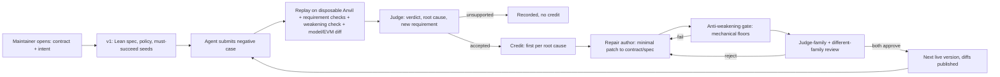

# Automatic negative-case loop

This loop extends the general contract-and-intent pipeline. Participants on Yukon submit **negative cases** against a live smart contract and its specification, and keep doing so until nobody can find another. A trusted, host-funded backend decides each case, credits it, repairs the contract and/or specification, and ships the next challenge version. There is no maintainer step after the challenge opens.



Design decisions D-1 to D-28 are recorded in `research/LEARNINGS.md` in the main checkout. The ones that shape this code:

| | Decision |
| --- | --- |
| D-2, D-3 | Fully automatic. Accepted cases are repaired in the contract and/or specification, and the patched contract goes live. |
| D-4, D-18 | A case no requirement covers creates a requirement. Ambiguous intent is resolved toward the party at risk and recorded. |
| D-5, D-6 | Within hard regression floors, the judge decides whether anything was weakened. Floors: accepted attacks must keep failing; must-succeed traces must keep succeeding. |
| D-7, D-8 | Automatic adoption counts as approval. No rollback; mistakes are fixed forward. |
| D-13 | Contributor prose reaches the judge only as quarantined data. It never reaches the repair author. |
| D-14, D-19 | Participants may submit raw attacker Solidity, which runs only inside the disposable EVM. Force-sent ether is in scope. |
| D-15, D-28 | The judge and repair author are `openai/gpt-6.1-sol`. The independent reviewer is `anthropic/claude-opus-5.5`. Model families must differ, and this is enforced. |
| D-16, D-26 | Credit goes to the first case per root-cause key. Weights: new root cause 1, weakening found 2, legitimate action blocked 1, Lean refutation +5, reproduction 0.25 (max 2 per case). |
| D-17 | Every version publishes diffs against the previous version and against v1. Finding a weakening earns double credit. |
| D-21, D-23, D-27 | Challenges never close and report a quiet period. Stale submissions resubmit; queued ones are rebased. Repairs are serialized. |

## Modules

| File | Responsibility |
| --- | --- |
| `general/chain.py` | Trace v2. Multi-contract environments owned by the policy, trusted setup actions, participant attacker contracts (solc with no imports and CPU/memory limits), forward-only time, and probes: views, contract balances, account balances, block timestamp. Private Anvil with zero gas price and fixed genesis. |
| `general/challenge.py` | Versioned challenge store: policy v2, contributions v2, stale/rebase binding, must-fail/must-succeed regression cases, append-only ledger and events, version adoption with published diffs, `CHALLENGE.md`, quiet-period status. |
| `general/models.py` | Host-funded OpenRouter transport: strict JSON schema, no tools, quarantine preamble, provenance recording without secrets. Recorded-response provider for tests and demonstrations. Model-family independence check. |
| `general/autoloop.py` | Per contribution: bind, replay, weakening check, judge (with one correction retry), mechanical validation of the judgment, confirmation of drafted requirements, credit with dedup, repair attempts, adoption, pending repairs retried before newer submissions. |
| `general/gate.py` | Anti-weakening gate: mechanical floors (below) and the two reviews. |
| `general/differential.py` | Model ↔ EVM differential. A trusted abstraction map runs each recorded trace through the generated Lean model with `#eval` in the network-free verifier image and compares it with Anvil, probe by probe. |
| `general/opening.py` | Opening (D-22) and v1 migration: proposer, policy author, seed replay, Lean compile, differential, different-family open review. |
| `general/evaluate.py`, `general/corpus/` | Held-out corpus: policy evaluation, mutation census, loop evaluation with held-out seeds and attacks. |
| `general/auto.py` | CLI: `open`, `migrate`, `process`, `preflight`, `status`. |
| `prompts/auto_*`, `schemas/auto_*` | Role instructions and strict output schemas. |

## The gate: what must hold before a version ships

Mechanical floors. Every one runs; none short-circuits, so the reviewers see all results.

1. The candidate specification, frozen snapshot and policy validate. Every requirement quotes the intent verbatim.
2. The contract compiles. Existing storage variables keep their slot, offset and type; new ones may only be appended. No new address literals appear. Function-level patch metrics are recorded.
3. Removing or changing a requirement must be declared, and only a `spec_defect` verdict may do it.
4. The submitted negative case is fixed. A requirement the case violated is also checked in its original form with its original probes.
5. Every accepted attack (must-fail case) no longer violates its **original** requirement under its **original** probes, even if that requirement was later rewritten.
6. Every legitimate trace (must-succeed case) succeeds on each listed action and violates none of the candidate's requirements.
7. The Lean model and frozen targets compile in the isolated verifier.
8. Model/EVM divergences on the recorded traces do not increase.

Then two reviews, bound to the candidate digest. The judge-family reviewer (D-5) and the independent different-family reviewer (D-15) must both approve, each with no weakening, no unrelated change and no over-restriction.

## What is and is not established

- **Established, for the recorded traces:** concrete EVM behaviour on a local chain, exact requirement predicates over trusted probes, regression survival, Lean compilation, and Lean/EVM agreement on modelled traces. Comparator plus NanoDa and con-ron kernel-check formal refutations.
- **Not established:** that the requirements capture English intent; that the Lean model corresponds to the contract beyond the recorded traces (`contract_correspondence: not_proved`); comprehensive security. A quiet period is never a security guarantee.
- **Approval** is `approved_automatically`. That's a governance decision (D-7), not a proof. The judge and reviewers can be wrong or deceived; the mechanical floors bound the damage, and published diffs plus the weakening bounty invite correction.

## Reproduce (no model account)

Needs Python 3.9+, Anvil/Cast 1.7.1, Solidity 0.8.28 (`AUTO_PROVE_SOLC`) and Docker with the pinned verifier image.

```sh
docker build -t auto-prove-verifier:lean4.35.0-rc2 general/verifier
bash scripts/verify_autoloop.sh          # unit suites + 30 end-to-end checks (~2 min)
python3 scripts/verify_autoloop.py --fast  # skip Docker Lean/differential
```

The script runs two demonstrations with **developer-authored recorded role responses**. Replay, Lean and kernel checks are real; the judgments are not live inference.

- **MilestoneEscrow** (the live challenge, migrated from v1):
  - a kernel-checked Lean refutation earns +5;
  - the double release is repaired to a cumulative limit (v2);
  - a duplicate is judged unsupported;
  - an outsider release creates a judge-drafted requirement under the safer reading. The first, over-restrictive patch is rejected by the must-succeed seeds and by a rise in Lean/EVM divergence; the second becomes v3;
  - a legitimate self-release flagged by a requirement gets a first repair that deletes the requirement. It passes the floors, but the independent reviewer rejects it as weakening; the second repair relaxes the predicate correctly (v4);
  - a false weakening claim is detected mechanically and judged unsupported;
  - an independent reproduction is credited.
- **ReentrantVault**, opened from creator input: a participant attacker contract re-enters `withdraw()`. The repair applies checks-effects-interactions, and the same attacker fails on v2. The differential labels the attacker trace `unmodeled` rather than claiming agreement.
- **Corpus:** the policy evaluation classifies 7/7 variants correctly. The mutation census kills 17/27 compiling mutants; survivors are listed, most are equivalent under the threat model, and they show where policies could observe more. The loop evaluation blocks held-out attacks after repair without over-restricting held-out legitimate traces.

## Operate

```sh
# Open a new challenge from creator input (live roles; sends input to OpenRouter)
OPENROUTER_API_KEY=... python3 -m general.auto open input.json --challenge challenge --output runs/live-open --roles openrouter
# Process a submission (hosted)
OPENROUTER_API_KEY=... python3 -m general.auto process --challenge challenge --submission submission \
  --output runs/live-process --score-path .yukon/score.json --roles openrouter
# Participant preflight (no model calls, not authoritative)
python3 -m general.auto preflight --challenge challenge --submission submission --output runs/reproduced-preflight
python3 -m general.auto status --challenge challenge
# Measure on the held-out corpus
python3 -m general.evaluate policy  --output runs/reproduced-eval-policy
python3 -m general.evaluate mutants --output runs/reproduced-eval-mutants
python3 -m general.evaluate loop --roles openrouter --output runs/live-eval-loop   # live judge/repair, token usage
```

Hosted on Yukon, `benchmark.yml` does the following:
- serializes runs;
- loads the authoritative challenge from the `challenge-state` branch;
- passes the submission commit time, which decides stale versus rebase;
- runs `.yukon/run.sh` with `AUTO_PROVE_HOSTED=1` and the `OPENROUTER_API_KEY` repository secret;
- commits the new state back to `challenge-state`.

The Yukon score is the cumulative ledger total, so only a submission that earns credit is promoted.

## Go-live checklist

1. Re-run the migration with live roles, so the v1 open review is a real different-family review rather than the recorded fixture: `python3 -m general.auto migrate challenge/legacy-v1 --seeds general/fixtures/auto/escrow/seeds.json --model-map general/fixtures/auto/escrow/model-map.json --challenge <fresh dir> --output runs/live-migrate --roles openrouter`. Then replace `challenge/` with the result.
2. Add the `OPENROUTER_API_KEY` repository secret. Optionally set the `CHALLENGE_BRANCH` variable; it defaults to `challenge-state`. Allow the workflow token to push that branch.
3. Confirm with the Yukon team that the cumulative-ledger score and the `challenge-state` branch fit the platform's promotion model.
4. Run `python3 -m general.evaluate loop --roles openrouter` on the corpus and review the judge's false-acceptance and over-restriction rates and its token cost. With automatic approval and no rollback (D-7, D-8), that error rate is the main risk.

## Known limits

- Attacker source is compiled on the host with solc under resource limits, without imports. Attacker bytecode runs only in the private Anvil EVM. Compiling inside the network-free container would harden this further.
- Probes read scalar views, balances and the block timestamp. Tuple/array views, events and storage-slot reads are not observable yet.
- The differential covers calls mapped by the abstraction map. Traces through attacker contracts are `unmodeled`, and the sequential Lean models do not represent reentrancy.
- Root-cause keys come from the judge. Semantically equal keys under different names would double-credit; that needs review in a rewarded pilot.
- Contract patches must compile as one source file with no imports or linked libraries.
